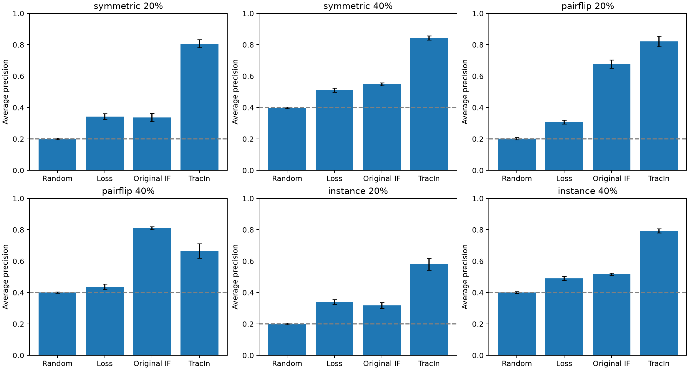
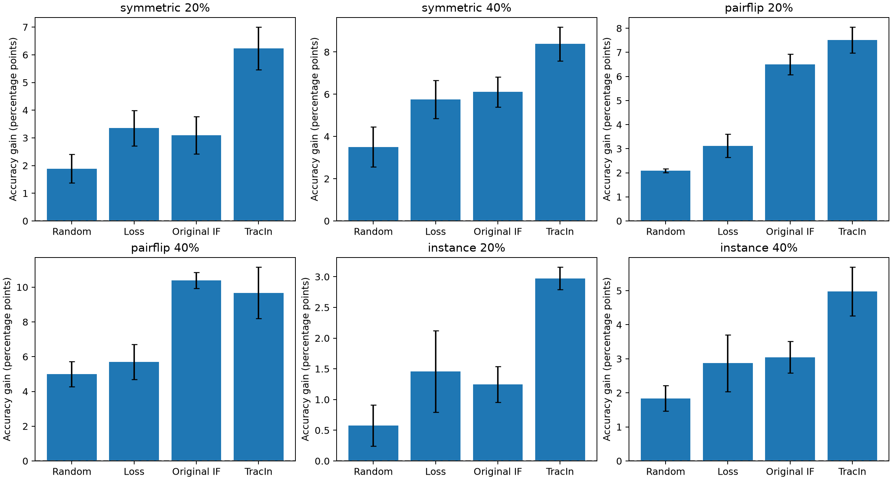
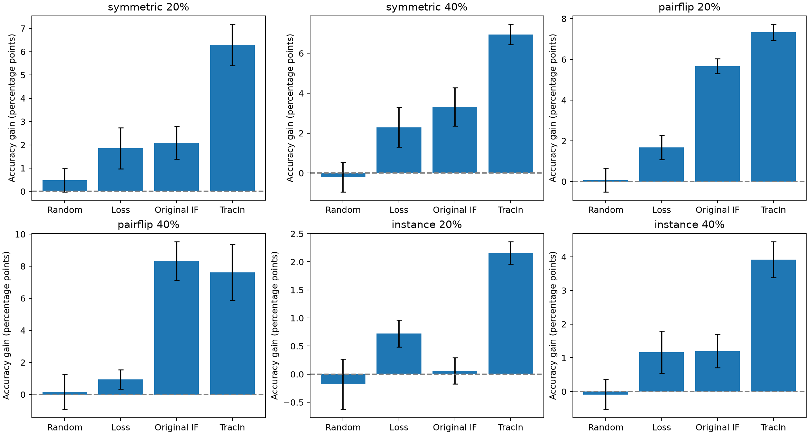

# Training Data Influence for Detecting Mislabeled Samples

CIFAR-10 / ResNet-18 课程项目最终结果仓库。比较 **Random、Training Loss、原始最后一层 Influence Functions、TracInCP 最后一层自影响** 四种方法。

## 主要结论

- TracIn 在六个设置中的五个取得这四种方法里最高的平均检测 AP；40% 类别依赖错标下原始 IF 最高。
- 在固定检查1,000张并恢复真实标签后，TracIn同样在五个设置取得最高平均测试准确率，40%类别依赖错标下原始IF最好。
- 方法优势依赖噪声结构；检测 AP 高不保证清理后准确率一定更高。报告均值和跨种子标准差，不将小幅均值差自动解释为统计显著。
- IF使用额外干净验证标签，TracIn使用训练历史，信息预算不同；结果不能仅归因于算法公式。

## 实验设计

| 项目 | 设置 |
|---|---|
| 数据集 | CIFAR-10，训练子集10,000张，官方测试集10,000张 |
| 网络 | CIFAR适配ResNet-18，从头训练；3×3 stem，无初始maxpool |
| 噪声 | 随机、类别依赖、实例依赖，各20%/40% |
| 随机种子 | 200–204，共5个 |
| 基础设置 | 3×2×5=30组 |
| 审核预算 | 每种方法选取前1,000张，训练集的10% |
| 清理动作 | oracle标签修正、删除；各从相同seed初始化完整重训 |
| 最终结果 | 4方法×2动作×30组=240行 |
| 训练 | SGD，batch128，7,900步，lr0.1，warmup5轮后cosine，FP32 |
| 干净参考 | 原实验5个干净模型的平均测试准确率86.63% |

详细方法、数据隔离及复现边界见[实验协议](docs/PROTOCOL.md)。

## 检测 AP

五种子均值 ± 样本标准差，越高越好。Random的参考水平随错误标签比例变化。

| 噪声 | 比例 | Random | Loss | 原始 IF | TracIn |
|---|---:|---:|---:|---:|---:|
| 随机错标 | 20% | 0.1998 ± 0.0041 | 0.3419 ± 0.0190 | 0.3365 ± 0.0259 | 0.8066 ± 0.0251 |
| 随机错标 | 40% | 0.3972 ± 0.0050 | 0.5110 ± 0.0131 | 0.5482 ± 0.0097 | 0.8433 ± 0.0132 |
| 类别依赖错标 | 20% | 0.2014 ± 0.0076 | 0.3075 ± 0.0119 | 0.6770 ± 0.0258 | 0.8213 ± 0.0344 |
| 类别依赖错标 | 40% | 0.4003 ± 0.0045 | 0.4366 ± 0.0177 | 0.8101 ± 0.0094 | 0.6653 ± 0.0452 |
| 实例依赖错标 | 20% | 0.2010 ± 0.0029 | 0.3408 ± 0.0154 | 0.3175 ± 0.0185 | 0.5800 ± 0.0375 |
| 实例依赖错标 | 40% | 0.4008 ± 0.0052 | 0.4907 ± 0.0129 | 0.5163 ± 0.0070 | 0.7933 ± 0.0130 |



## 修正后测试准确率（%）

修正使用真实标签模拟人工审核，不是自动预测新标签。

| 噪声 | 比例 | Random | Loss | 原始 IF | TracIn |
|---|---:|---:|---:|---:|---:|
| 随机错标 | 20% | 73.87 ± 0.73 | 75.34 ± 0.75 | 75.08 ± 0.55 | 78.21 ± 0.57 |
| 随机错标 | 40% | 56.81 ± 0.69 | 59.06 ± 0.43 | 59.41 ± 0.73 | 61.69 ± 0.42 |
| 类别依赖错标 | 20% | 73.45 ± 0.39 | 74.48 ± 0.18 | 77.86 ± 0.39 | 78.87 ± 0.67 |
| 类别依赖错标 | 40% | 55.89 ± 0.35 | 56.59 ± 1.16 | 61.28 ± 0.52 | 60.56 ± 1.48 |
| 实例依赖错标 | 20% | 79.71 ± 0.33 | 80.59 ± 0.72 | 80.38 ± 0.35 | 82.11 ± 0.27 |
| 实例依赖错标 | 40% | 70.41 ± 0.29 | 71.44 ± 0.70 | 71.62 ± 0.31 | 73.55 ± 0.40 |

## 修正后相对基础模型的提升（百分点）

| 噪声 | 比例 | Random | Loss | 原始 IF | TracIn |
|---|---:|---:|---:|---:|---:|
| 随机错标 | 20% | 1.89 ± 0.51 | 3.36 ± 0.64 | 3.10 ± 0.67 | 6.23 ± 0.77 |
| 随机错标 | 40% | 3.50 ± 0.94 | 5.76 ± 0.90 | 6.11 ± 0.72 | 8.38 ± 0.80 |
| 类别依赖错标 | 20% | 2.09 ± 0.07 | 3.12 ± 0.48 | 6.50 ± 0.42 | 7.51 ± 0.54 |
| 类别依赖错标 | 40% | 5.01 ± 0.73 | 5.71 ± 1.01 | 10.39 ± 0.46 | 9.68 ± 1.48 |
| 实例依赖错标 | 20% | 0.57 ± 0.33 | 1.46 ± 0.67 | 1.25 ± 0.29 | 2.97 ± 0.18 |
| 实例依赖错标 | 40% | 1.84 ± 0.37 | 2.87 ± 0.84 | 3.05 ± 0.47 | 4.98 ± 0.72 |



## 删除后测试准确率（%）

| 噪声 | 比例 | Random | Loss | 原始 IF | TracIn |
|---|---:|---:|---:|---:|---:|
| 随机错标 | 20% | 72.46 ± 0.48 | 73.83 ± 1.10 | 74.07 ± 0.42 | 78.27 ± 0.57 |
| 随机错标 | 40% | 53.10 ± 0.27 | 55.60 ± 0.48 | 56.63 ± 1.13 | 60.25 ± 0.53 |
| 类别依赖错标 | 20% | 71.43 ± 0.79 | 73.04 ± 0.87 | 77.03 ± 0.15 | 78.70 ± 0.53 |
| 类别依赖错标 | 40% | 51.06 ± 0.58 | 51.83 ± 0.37 | 59.21 ± 0.83 | 58.51 ± 1.55 |
| 实例依赖错标 | 20% | 78.96 ± 0.49 | 79.86 ± 0.32 | 79.19 ± 0.31 | 81.29 ± 0.32 |
| 实例依赖错标 | 40% | 68.48 ± 0.65 | 69.74 ± 0.45 | 69.77 ± 0.55 | 72.48 ± 0.31 |



图中误差线均为跨种子SD，不是置信区间。TracIn在20%随机错标下删除准确率78.27%、修正78.21%，差异很小，因此不能声称修正始终优于删除。

## 成本与实用性

| 方法 | 主要额外成本 | 本次30组实际记录 |
|---|---|---|
| Random | 随机排序 | 未独立计时，计算很少 |
| Loss | 最终模型的一次前向评价 | 未独立计时 |
| 原始IF | 特征、干净验证梯度、头部CG | 原实验共享特征33.47秒；共享评分批次11.32秒，不能当作该方法独立耗时 |
| TracIn | 9个历史checkpoint的特征和梯度评分 | 为补齐历史轨迹补训3.13小时；评分未独立计时 |

IF需要额外2,000个干净归因标签。TracIn若在原训练中预先保存checkpoint，可避免本次轨迹补训，但仍有评分与存储成本。每种方法60次清理重训约6–7小时，这主要是比较方法效果的实验成本。实际硬件为单个H100 MIG 3g.40gb，不是8卡运行。

## 文件与复现

- [data/results.csv](data/results.csv)：240条完整逐种子结果，含AP、AUROC、P/R@10%、accuracy、test loss和耗时。
- [data/summary.csv](data/summary.csv)：各指标均值和样本标准差。
- [data/validation.json](data/validation.json)：结果矩阵与指标一致性验证。
- [config/training.json](config/training.json)：原冻结训练参数。
- [config/splits_manifest.json](config/splits_manifest.json)：数据及划分身份哈希。
- [data/provenance.json](data/provenance.json)：源表SHA256和保留方法。
- [scripts/build_results.py](scripts/build_results.py)：重建此README、统计表和图，并验证数据。

```bash
python -m venv .venv
source .venv/bin/activate
pip install -r requirements.txt
python scripts/build_results.py
```

本仓库定位为**最终结果与统计复现仓库**：上述命令重算表格和图，不重新训练模型。原始训练源码、图像数据、逐样本分数及模型权重仍保留在原项目/服务器，未打包进本仓库。不能仅凭汇总结果重新核验每张图的AP排序。

## 局限

仅一个数据集、固定划分和预算、五个种子；噪声为合成噪声。两种影响方法都仅使用最后分类层，不能代表全网络影响估计。最终四方法汇总是在完整实验之后整理形成的描述性比较，不是新的预注册显著性检验。未对多重比较作校正；不宣称某方法在所有任务中最好。
